# 🧠 Computer Vision & Object Detection using OpenCV, YuNet & YOLOv8

> 🚀 A practical Computer Vision project demonstrating **classical image processing, face detection, object detection, real-time webcam processing, threshold tuning, and performance benchmarking** using Python.

---

## 📌 Project Overview

This project is a hands-on Computer Vision practical built with **OpenCV, NumPy, Matplotlib, YuNet, and YOLOv8**.

It progresses from fundamental image-processing operations to modern deep-learning-based detection and finally combines the techniques into a **real-time integrated computer-vision pipeline**.

🎥 **Video:** [`Explanation Video`](https://drive.google.com/file/d/1wMT6D6rbSEs8DCrnSy6kEquVZE1eAoVn/view?usp=sharing)
---

### 🎯 Main Objectives

- 🖼️ Load and analyze grayscale and color images
- ⚫ Convert images into binary representations
- 🧹 Perform morphological image processing
- 🔗 Apply bitwise image operations
- 📊 Generate grayscale and BGR color histograms
- ☀️ Adjust image brightness and contrast
- 🙂 Detect faces using **YuNet**
- 🎯 Detect objects using **YOLOv8n**
- 🎚️ Experiment with confidence and IoU thresholds
- 📹 Perform real-time webcam detection
- ⚡ Measure and compare FPS performance
- 🧩 Build an integrated YuNet + YOLOv8 pipeline
- 🛡️ Demonstrate privacy-preserving face blurring

---

## 🛠️ Technologies Used

| Technology | Purpose |
|---|---|
| 🐍 **Python** | Core programming language |
| 👁️ **OpenCV** | Image processing, webcam, morphology & detection |
| 🔢 **NumPy** | Numerical and array operations |
| 📈 **Matplotlib** | Image visualization and graphs |
| 🙂 **YuNet** | Lightweight real-time face detection |
| 🎯 **YOLOv8n** | Real-time object detection |
| 📓 **Jupyter Notebook** | Practical implementation environment |
| 🤗 **Ultralytics** | YOLOv8 framework |

---

## 📂 Project Structure

```text
PR 3/
│
├── 📓 Pr_3.ipynb
│
├── 📁 data/
│   ├── 📁 images/
│   │   ├── cars.jpeg
│   │   ├── cr.jpg
│   │   ├── GRAY_spidy.jpg
│   │   ├── loki.jpg
│   │   ├── luffy.png
│   │   ├── objs.png
│   │   ├── powerrangers.jpeg
│   │   ├── tony.jpg
│   │   ├── walter.jpg
│   │   ├── yash.jpeg
│   │   └── yash2.jpeg
│   │
│   └── 📁 models/
│       ├── face_detection_yunet_2023mar.onnx
│       └── yolov8n.pt
│
├── 📁 output/
│   ├── bgr_histogram.png
│   ├── binary_image.png
│   ├── binary_image2.png
│   ├── blur_image.png
│   ├── bright&dark_image.png
│   ├── conf_vs_detected.png
│   ├── detection_summery.png
│   ├── detect_image.png
│   ├── fps_compare.png
│   ├── gray_histogram.png
│   ├── IoU_detect.png
│   ├── IoU_vs_detected.png
│   ├── kernelshape_image.png
│   ├── masks_image.png
│   ├── mask_overlay_image.png
│   ├── morphological_image.png
│   ├── objs_detect.png
│   └── pre_clean_morpho.png
│
└── 📄 README.md
```

---

# 🧪 Practical Tasks

## 1️⃣ Fundamental Image Processing

### 🖼️ Image Loading

The project loads both:

- ⚫ Grayscale images
- 🌈 Color images

It also checks the image **shape** and **data type**.

### ⚫ Image Binarization

A grayscale image is converted into a binary image using thresholding.

```python
_, binary = cv2.threshold(
    gray,
    127,
    255,
    cv2.THRESH_BINARY
)
```

This separates pixels into foreground and background regions.

---

## 2️⃣ Morphological Image Processing 🧹

Four fundamental morphological operations are implemented:

| Operation | Description |
|---|---|
| 🔻 **Erosion** | Shrinks white regions and removes small bright noise |
| 🔺 **Dilation** | Expands white regions and fills small gaps |
| 🧹 **Opening** | Erosion → Dilation; useful for removing noise |
| 🧱 **Closing** | Dilation → Erosion; useful for filling holes and gaps |

### 🔬 Kernel Comparison

Different structuring-element shapes and sizes are tested:

- ▫️ Rectangle
- 🥚 Ellipse
- ➕ Cross
- 📏 3×3
- 📏 5×5
- 📏 9×9

This demonstrates how kernel geometry affects morphological results.

---

## 3️⃣ Bitwise Image Operations 🔗

The project demonstrates:

- `AND`
- `OR`
- `XOR`
- `NOT`

Two masks containing geometric shapes are created and combined using OpenCV bitwise operations.

### 🎯 Practical Use Case

Bitwise masking is also used to isolate a selected region of an image.

---

## 4️⃣ Histograms & Image Enhancement 📊

### ⚫ Grayscale Histogram

The intensity distribution of a grayscale image is calculated using:

```python
cv2.calcHist()
```

### 🌈 BGR Histogram

Separate histograms are generated for:

- 🔵 Blue
- 🟢 Green
- 🔴 Red

### ☀️ Brightness & Contrast

Image enhancement is demonstrated using:

```python
cv2.convertScaleAbs()
```

Two important parameters are explored:

- **α (Alpha)** → controls contrast
- **β (Beta)** → controls brightness

---

# 🙂 5️⃣ Face Detection with YuNet

The project uses the lightweight **YuNet face detector** for fast face detection.

### 🔍 Features

- 🙂 Face bounding boxes
- 🎯 Confidence scores
- 📍 5-point facial landmarks
- ⚡ Real-time webcam detection
- 🛡️ Face-region privacy blurring
- 🎚️ Score-threshold experiments

### 📈 Threshold Experiment

The detector is tested using different confidence thresholds:

```text
0.5
0.7
0.9
```

A lower threshold can detect more faces but may increase false positives, while a higher threshold is more selective.

### 🛡️ Privacy Blur

Detected face regions can be blurred automatically to demonstrate a simple privacy-preserving application.

---

# 🎯 6️⃣ Object Detection with YOLOv8

The project uses **YOLOv8 Nano (`yolov8n.pt`)** for object detection.

```python
from ultralytics import YOLO

model = YOLO("yolov8n.pt")
results = model(image_path)
```

### 🚀 YOLOv8 Capabilities

- 📦 Bounding-box detection
- 🏷️ Object classification
- ⚡ Real-time inference
- 📹 Webcam detection
- 🎯 Confidence threshold control
- 🔗 IoU threshold control

YOLOv8n is selected because it is lightweight and suitable for real-time applications.

---

## 🎚️ 7️⃣ Confidence & IoU Experiments

### Confidence Threshold

Tested values:

```text
0.25
0.50
0.75
```

Increasing the confidence threshold generally makes detection more selective.

### IoU Threshold

Tested values:

```text
0.30
0.50
0.70
```

IoU is important for controlling how overlapping detection boxes are handled during Non-Maximum Suppression (NMS).

---

# 📊 8️⃣ Per-Class Detection Summary

The project analyzes multiple images and counts detected object classes.

Example workflow:

```python
class_counts = Counter()

for path in image_paths:
    results = model(path, verbose=False)

    for cls_id in results[0].boxes.cls.tolist():
        class_name = model.names[int(cls_id)]
        class_counts[class_name] += 1
```

This provides a simple summary of the detected classes across the test images.

---

# 🧩 9️⃣ Integrated Computer Vision Pipeline

The final stage combines multiple techniques into a single real-time workflow:

```text
             📹 Webcam
                 │
                 ▼
        🧹 Image Preprocessing
                 │
        ┌────────┴────────┐
        ▼                 ▼
   🙂 YuNet            🎯 YOLOv8
 Face Detection       Object Detection
        │                 │
        └────────┬────────┘
                 ▼
          📦 Annotated Frame
                 │
                 ▼
             ⚡ FPS
```

The integrated pipeline demonstrates how classical image processing and deep-learning-based detection can work together in a real-time application.

---

# 🧹 🔟 Morphological Pre-Cleaning

Artificial noise is added to an image and morphological opening is applied to clean it.

### Pipeline

```text
Original Image
      ↓
Add Noise
      ↓
Noisy Image
      ↓
Morphological Opening
      ↓
Cleaned Image
```

This demonstrates how classical image-processing techniques can improve the quality of an image before further analysis.

---

# ⚡ 1️⃣1️⃣ FPS Benchmarking

The project captures the same set of webcam frames and benchmarks detection performance.

The benchmark compares the processing speed of different modes.

### 📌 Why FPS Matters

Higher FPS means:

- ⚡ Faster processing
- 🎥 Smoother real-time video
- 🖥️ Better responsiveness
- 📱 Better suitability for edge devices

The generated `fps_compare.png` provides a visual performance comparison.

---

# 📋 Final Technique Comparison

| Technique | Type | Main Purpose | Speed | Best Use Case |
|---|---|---|---|---|
| 🧹 Morphology | Classical CV | Noise removal & shape processing | ⚡ Very Fast | Image cleaning |
| 🔗 Bitwise Operations | Classical CV | Masking & logical image operations | ⚡ Very Fast | Region selection |
| 📊 Histograms | Classical CV | Pixel-distribution analysis | ⚡ Very Fast | Image analysis |
| 🙂 YuNet | Deep Learning | Face detection | 🚀 Fast | Real-time face detection |
| 🎯 YOLOv8n | Deep Learning | Object detection | 🚀 Fast | Real-time multi-object detection |

---

# 💻 Installation

## 1. Clone the Repository

```bash
git clone <YOUR-GITHUB-REPOSITORY-URL>
cd "PR 3"
```

## 2. Create a Virtual Environment

### Windows

```bash
python -m venv venv
venv\Scripts\activate
```

### Linux / macOS

```bash
python3 -m venv venv
source venv/bin/activate
```

## 3. Install Dependencies

```bash
pip install opencv-python opencv-contrib-python ultralytics matplotlib numpy
```

> 💡 The notebook also contains the installation command used for the practical environment.

---

# ▶️ How to Run

### Option 1 — Jupyter Notebook

```bash
jupyter notebook
```

Open:

```text
Pr_3.ipynb
```

Then run the cells sequentially.

### Option 2 — VS Code

1. Open the project folder in VS Code.
2. Install the **Jupyter** extension.
3. Open `Pr_3.ipynb`.
4. Select your Python environment.
5. Run the cells from top to bottom.

---

# 📷 Webcam Requirements

The real-time sections use:

```python
cv2.VideoCapture(0)
```

Therefore:

- 📹 A working webcam is required.
- 🔐 Camera permission must be enabled.
- 💻 A laptop/desktop with a webcam is recommended.

> 🛑 Press **`q`** in the OpenCV webcam window to stop the real-time detection loop.

---

# 📈 Output Files

The `output/` folder contains generated visual results such as:

- 🖼️ Binary images
- 🧹 Morphological results
- 🔗 Mask operations
- 📊 Histograms
- ☀️ Brightness/contrast results
- 🙂 Face detection results
- 🛡️ Privacy-blurred faces
- 🎯 YOLO object detections
- 📦 Detection summaries
- 🎚️ Confidence experiments
- 📐 IoU experiments
- ⚡ FPS comparison
- 🧼 Morphological pre-cleaning

---

# 🧠 Key Concepts Learned

### Classical Computer Vision

- Image loading
- Grayscale conversion
- Binary thresholding
- Morphological operations
- Structuring elements
- Bitwise operations
- Image masking
- Histograms
- Brightness and contrast adjustment

### Deep Learning Computer Vision

- Face detection
- Object detection
- Confidence scores
- IoU
- Non-Maximum Suppression
- Real-time inference
- FPS benchmarking
- Lightweight detection models

---

# 🌍 Real-World Applications

This project demonstrates techniques that can be extended to:

- 🏭 Industrial inspection
- 🚗 Traffic monitoring
- 🛡️ Security systems
- 📹 Smart surveillance
- 🧑‍💻 Privacy-preserving video processing
- 🚘 Vehicle detection
- 🏠 Smart-home cameras
- 🤖 Robotics
- 🏥 Healthcare image analysis
- 📱 Edge AI applications

---

# 📸 Output Gallery

> The following results are generated directly from the practical notebook and are included in the repository for quick visual inspection.

### 🖼️ Image Processing Outputs

<table><tr>
<tr>
<td align="center">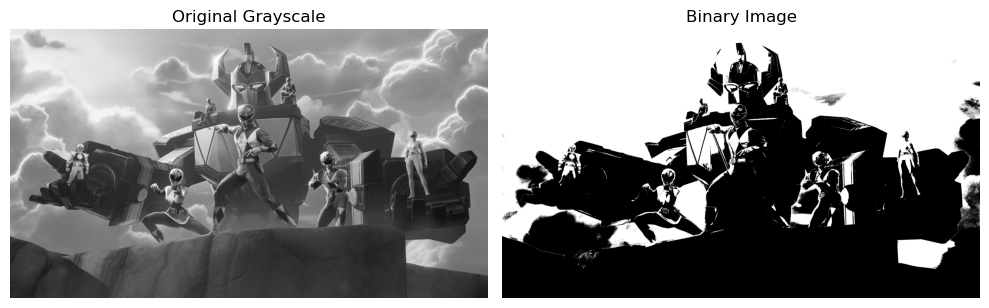<br><sub><b>binary image</b></sub></td>
<td align="center">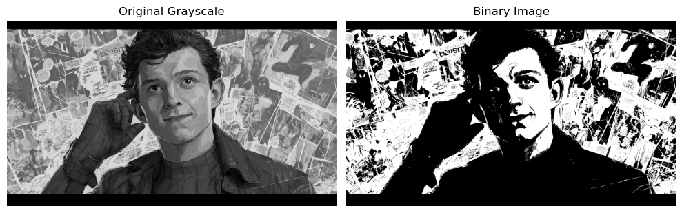<br><sub><b>binary image2</b></sub></td>
</tr>
<tr>
<td align="center">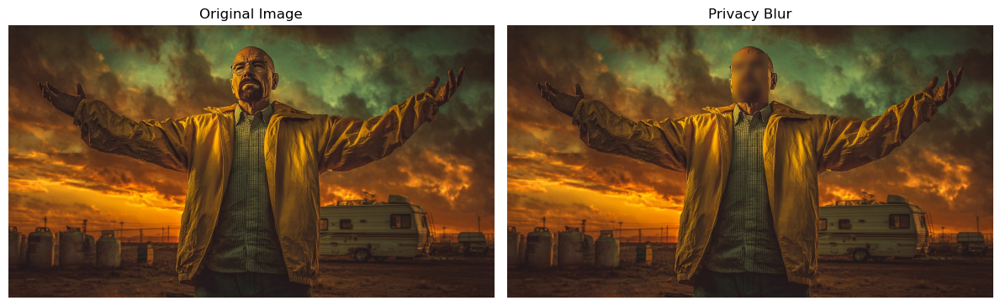<br><sub><b>blur image</b></sub></td>
<td align="center">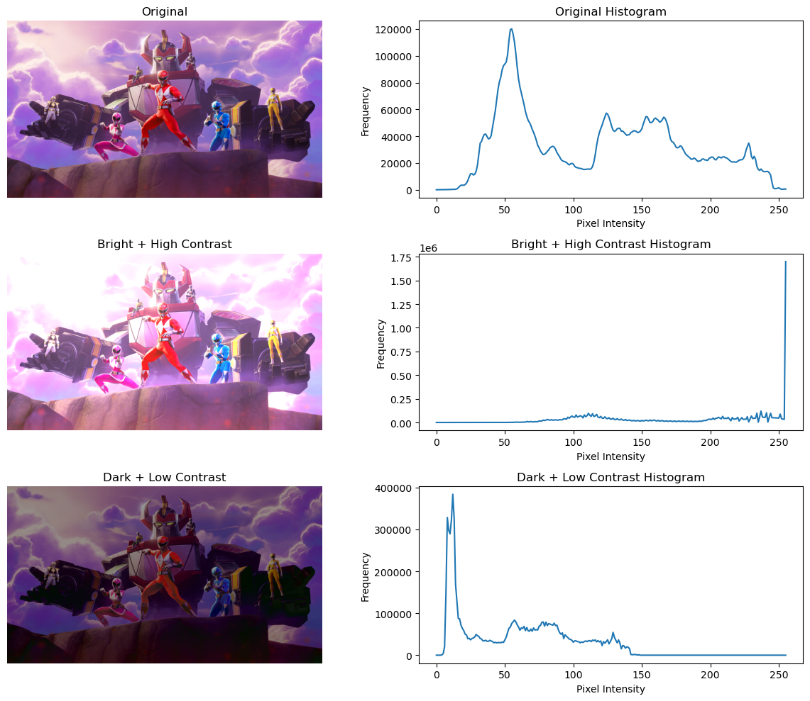<br><sub><b>bright & dark image</b></sub></td>
</tr>
</table>

### 🧹 Morphological Processing

<table><tr>
<tr>
<td align="center">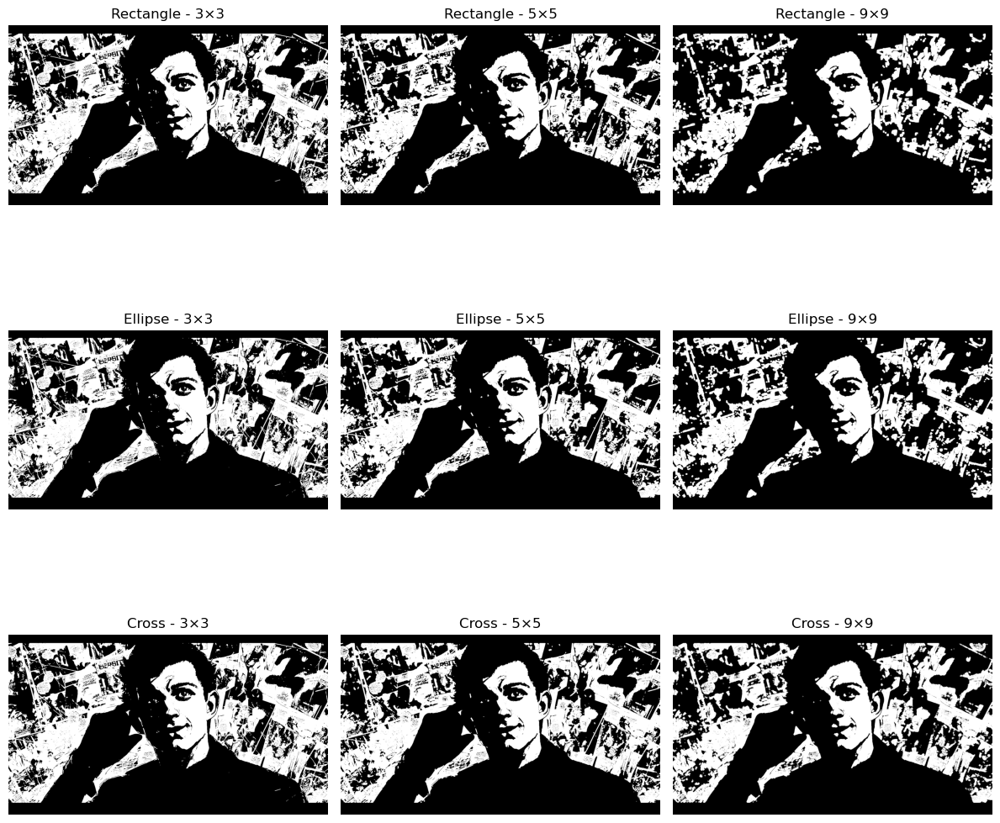<br><sub><b>kernelshape image</b></sub></td>
<td align="center">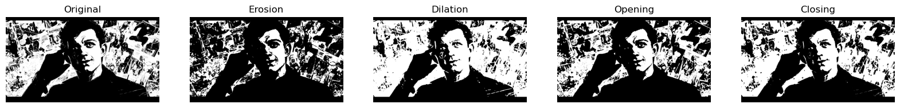<br><sub><b>morphological image</b></sub></td>
</tr>
<tr>
<td align="center">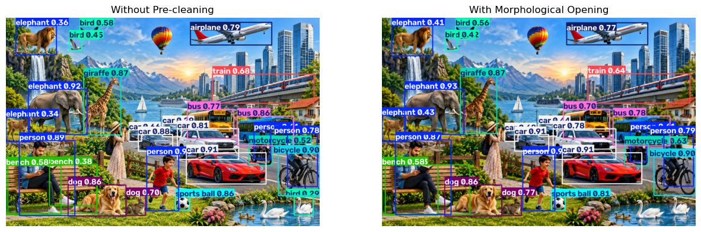<br><sub><b>pre clean morpho</b></sub></td>
</tr>
</table>

### 🔗 Bitwise & Masking

<table><tr>
<tr>
<td align="center">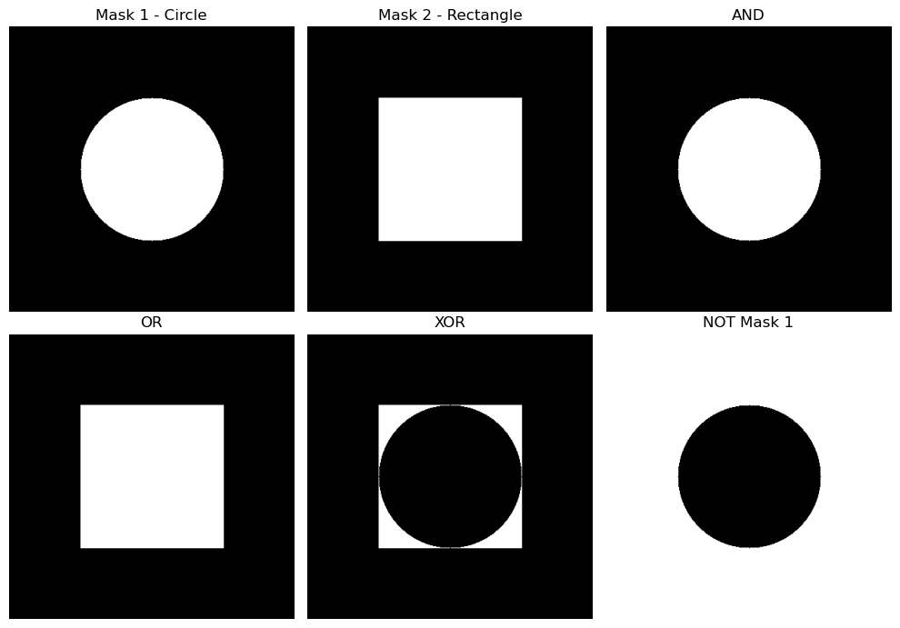<br><sub><b>masks image</b></sub></td>
<td align="center">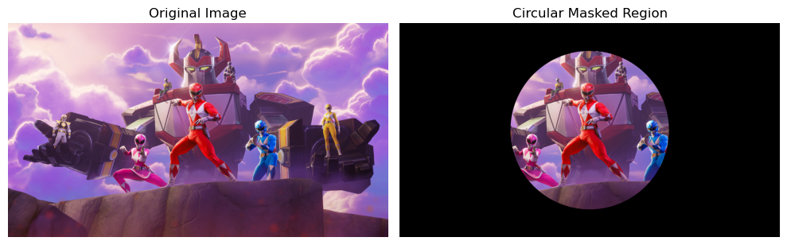<br><sub><b>mask overlay image</b></sub></td>
</tr>
</table>

### 📊 Histogram Analysis

<table><tr>
<tr>
<td align="center">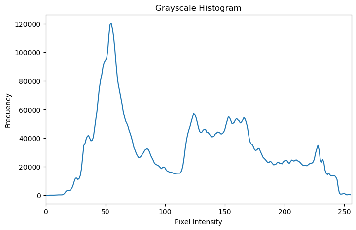<br><sub><b>gray histogram</b></sub></td>
<td align="center">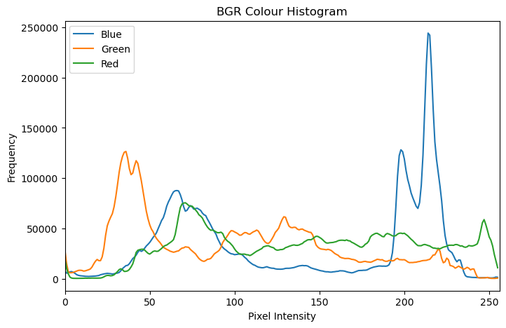<br><sub><b>bgr histogram</b></sub></td>
</tr>
</table>

### 🙂 Face & Object Detection

<table><tr>
<tr>
<td align="center">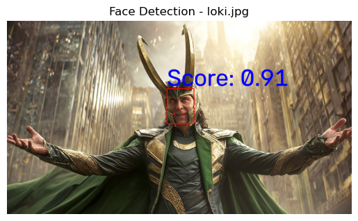<br><sub><b>detect image</b></sub></td>
<td align="center">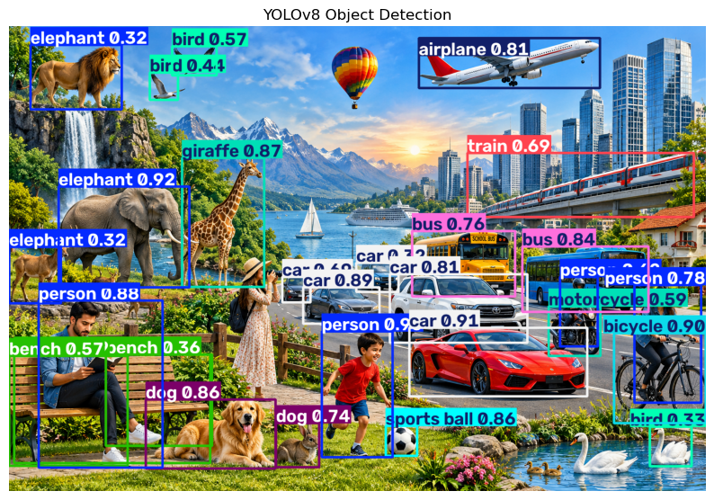<br><sub><b>objs detect</b></sub></td>
</tr>
<tr>
<td align="center">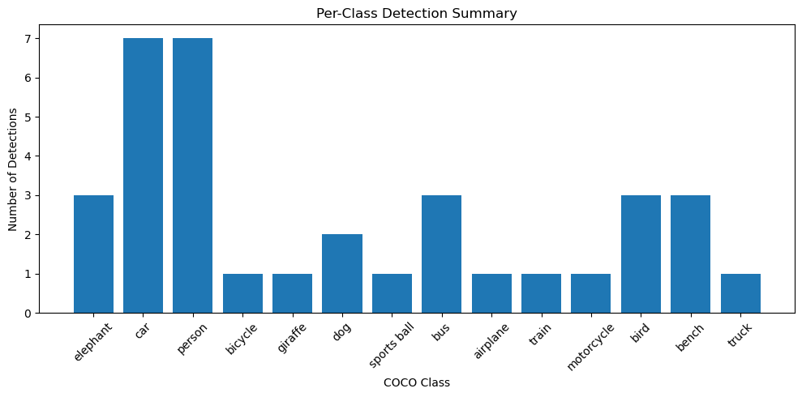<br><sub><b>detection summery</b></sub></td>
</tr>
</table>

### 🎚️ Detection Experiments

<table><tr>
<tr>
<td align="center">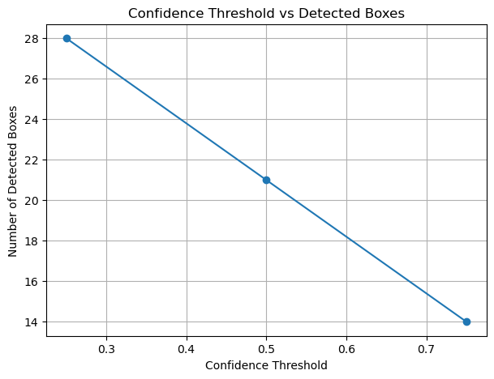<br><sub><b>conf vs detected</b></sub></td>
<td align="center">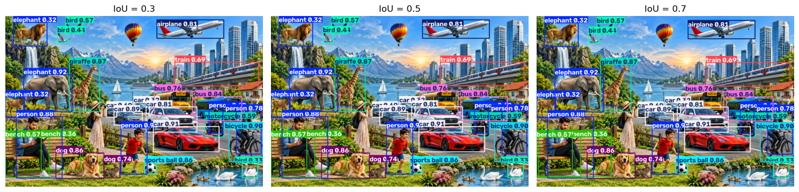<br><sub><b>IoU detect</b></sub></td>
</tr>
<tr>
<td align="center">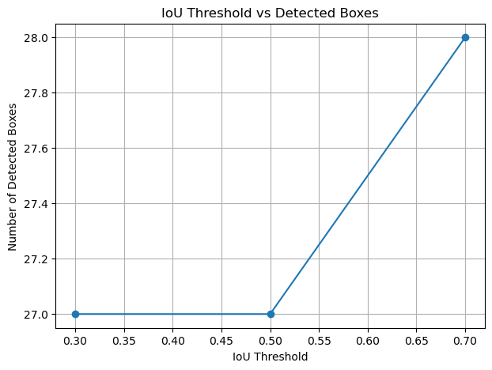<br><sub><b>IoU vs detected</b></sub></td>
</tr>
</table>

### ⚡ Performance

<table><tr>
<tr>
<td align="center">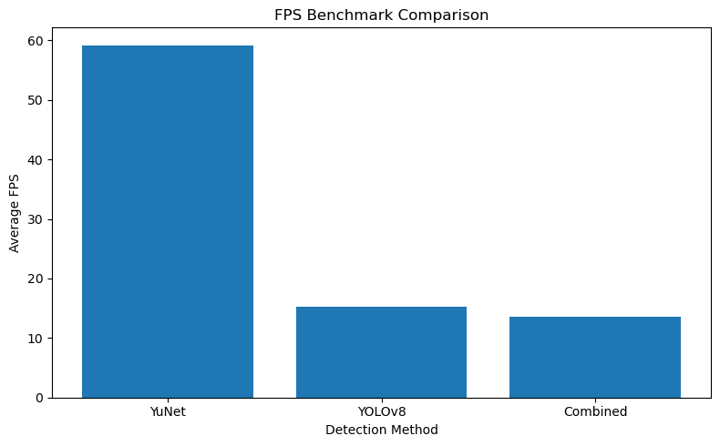<br><sub><b>fps compare</b></sub></td>
</tr>
</table>

### 📁 Complete Output Files

All generated output images are available in the [`output/`](output/) folder:

- 🖼️ `IoU_detect.png`
- 🖼️ `IoU_vs_detected.png`
- 🖼️ `bgr_histogram.png`
- 🖼️ `binary_image.png`
- 🖼️ `binary_image2.png`
- 🖼️ `blur_image.png`
- 🖼️ `bright&dark_image.png`
- 🖼️ `conf_vs_detected.png`
- 🖼️ `detect_image.png`
- 🖼️ `detection_summery.png`
- 🖼️ `fps_compare.png`
- 🖼️ `gray_histogram.png`
- 🖼️ `kernelshape_image.png`
- 🖼️ `mask_overlay_image.png`
- 🖼️ `masks_image.png`
- 🖼️ `morphological_image.png`
- 🖼️ `objs_detect.png`
- 🖼️ `pre_clean_morpho.png`

# 🏆 Project Highlights

✨ **End-to-end Computer Vision practical**

✅ Classical image processing  
✅ Morphological image cleaning  
✅ Bitwise masking  
✅ Histogram analysis  
✅ Image enhancement  
✅ YuNet face detection  
✅ YOLOv8 object detection  
✅ Real-time webcam inference  
✅ Confidence & IoU experiments  
✅ Per-class detection analysis  
✅ FPS benchmarking  
✅ Integrated detection pipeline  
✅ Privacy blur demonstration  

---

# 📚 Models Used

## 🙂 YuNet

**YuNet** is a lightweight face detector designed for efficient face detection, making it suitable for real-time applications and resource-constrained environments.

Model file:

```text
data/models/face_detection_yunet_2023mar.onnx
```

## 🎯 YOLOv8n

**YOLOv8 Nano** is a lightweight object-detection model from Ultralytics.

Model file:

```text
data/models/yolov8n.pt
```

---

# ⚠️ Notes

- 📁 Keep the `data/` folder in the same project structure because notebook paths depend on it.
- 📁 Keep the model files available before running detection cells.
- 📹 Webcam functionality requires camera access.
- ⚡ Actual FPS depends on CPU/GPU, camera resolution, and system load.
- 🎚️ Detection results can change with confidence and IoU thresholds.
- 🧪 For reproducible benchmarking, use the same frames and environment.

---

# 👨‍💻 Author

**Badshaa**

🎓 B.Tech Computer Engineering Student  
💻 Computer Vision & AI/ML Enthusiast

---

# ⭐ If You Like This Project

If this project helped you understand Computer Vision:

⭐ **Star the repository**  
🍴 **Fork the repository**  
📢 **Share it with others**  
💡 **Experiment with your own images and models**

---

## 🚀 Future Improvements

Possible extensions include:

- 🔥 YOLOv8 GPU acceleration
- 📱 Deployment on edge devices
- 🌐 Web-based detection dashboard
- 📊 More detailed benchmark reports
- 🧠 Custom-trained YOLO model
- 👥 Multi-face tracking
- 🎥 Video-file detection
- 🔒 Advanced privacy-preserving processing
- 📈 Automated model-performance evaluation

---

## 📜 License

This project is intended for **educational and academic purposes**.

If you reuse or extend the project, please provide appropriate attribution to the original work and the third-party libraries/models used.
